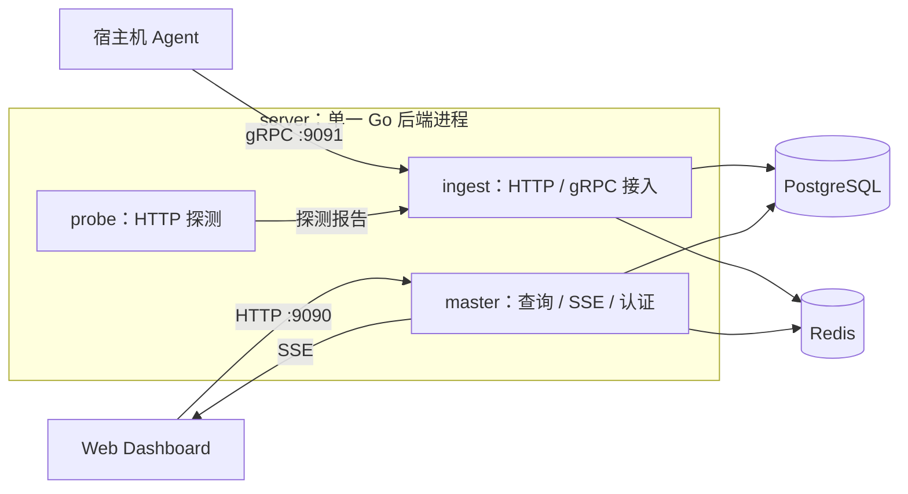

# 高明 / Gaoming


> 高明是明代神魔小说《封神演义》中的虚拟角色，本体为棋盘山桃精，与其弟柳鬼高觉（顺风耳）并称千里眼。

## 🚀 快速体验

```bash
curl -fsSL https://raw.githubusercontent.com/gofxq/gaoming/master/deployments/install-agent.sh | sudo sh
```

安装完成后展示：
```bash
[+] downloading gaoming-agent_linux_amd64.tar.gz
[+] installed gaoming-agent to /opt/gaoming-agent
[+] config: /opt/gaoming-agent/agent-config.yaml
[+] tenant_code: default
[+] dashboard: https://gm-metric.gofxq.com/default
```


安装完成后打开dashboard即可。手机端可打开增加 pwa 支持安装至手机。

[PWA](https://gm-metric.gofxq.com/default/pwa)


一个面向主机与节点的轻量监控系统：Agent 自动注册、持续上报指标，Web 端按租户展示实时状态。


🔗 在线 Demo: [https://gaoming.gofxq.com/default](https://gaoming.gofxq.com/default)
## WEB


## ✨ 核心能力

- Agent 自动注册、流式指标上报
- Dashboard 实时展示主机状态与窗口指标
- 租户隔离：页面走 `/<tenantCode>`，接口走 `?tenant=...`
- 支持 Linux / macOS / Windows 安装脚本
- 支持 Docker 启动后端，本机直跑 Agent 调试
  

## 💻 系统方案





## ⚡️ 快速开始

推荐本地开发：PostgreSQL 和 Redis 使用 Docker，后端 `server` 是一个 Go 服务并在宿主机运行；Agent 单独运行，采集宿主机数据。

首次准备依赖与配置，详见[本地开发与验证](docs/02-guides/local-development.md)：

```bash
make deps-up       # 通过 Docker 启动 PostgreSQL / Redis，首次生成随机凭据
```

首次使用空库时，先通过 PostgreSQL 客户端执行 `deployments/sql/init.sql`，见[数据库初始化](docs/02-guides/database-setup.md)。完成后启动服务：

```bash
make dev           # 启动统一后端与前端；Ctrl-C 停止
make deps-down     # 停止依赖容器，保留数据库卷
```

页面地址：`http://127.0.0.1:5173/default`。统一 HTTP 端口 9090 同时提供 `/master/*` 和 `/ingest/*`，gRPC 端口 9091 提供 Agent 接入；端口均监听 `0.0.0.0`。

另一终端准备 `agent-config.yaml` 并运行：

```yaml
master_api_url: "http://127.0.0.1:9090"
ingest_gateway_grpc_addr: "127.0.0.1:9091"
region: local
env: dev
role: node
tenant_code: default
loop_interval_sec: 1
```

```bash
make run-agent
```

统一后端启动时，若整个 `users` 表为空，会自动创建 `default` 租户的管理员 `admin`。密码读取 `GAOMING_ADMIN_PASSWORD`，未设置或为空则使用 `G@oming`；已有任何用户时不创建、不重置密码。详见[管理员登录](docs/02-guides/local-development.md#3-管理员登录)。

常用命令：

```bash
make backend       # 只运行统一后端
make air           # 热更新统一后端 + 前端
make smoke         # 验证统一后端健康及接入计数器
make test          # Go 测试
make web-install   # 首次安装前端依赖
make test-all      # Go + 前端测试
make help          # 分组命令说明
```

端口冲突时用 `make dev HTTP_PORT=18080 GRPC_PORT=18091 WEB_PORT=15173`，同步更新 Agent 地址和配置里的 `allowed_origins`。数据库端口在 `config/server.yml` 中设置。

依赖需要 Docker Compose，PostgreSQL 数据保存在持久数据卷，`.local-data/` 保存私有配置和管理状态，`make clean` 会保留。使用已有本机实例时可执行 `make dev-init` 并修改配置中的凭据。

Docker 将 Go 后端和生产 Web 静态文件打包在同一个容器中：执行 `make docker-up` 后访问 `http://127.0.0.1:9090/default`，页面与 API 共用 HTTP 端口。默认 Compose 只有 server、PostgreSQL、Redis；容器 Agent 通过 `DOCKER_PROFILES="--profile container-agent"` 按需启动。本机开发仍使用 `make dev` / `make web-dev` 的 Vite 热更新。

## 📦 安装 Agent

Linux / macOS（x64、ARM64）：

```sh
curl -fsSL https://raw.githubusercontent.com/gofxq/gaoming/master/deployments/install-agent.sh | sudo sh
```

Windows（x64、ARM64），在 PowerShell 中执行：

```powershell
$p=Join-Path $env:TEMP ('gaoming-install-'+[guid]::NewGuid()+'.ps1'); try { iwr https://raw.githubusercontent.com/gofxq/gaoming/master/deployments/install-agent.ps1 -UseBasicParsing -OutFile $p; powershell -NoProfile -ExecutionPolicy Bypass -File $p; if ($LASTEXITCODE -ne 0) { throw 'Agent installation failed' } } finally { Remove-Item -LiteralPath $p -Force -ErrorAction SilentlyContinue }
```

脚本自动识别架构、下载最新 Release、校验 SHA256、写入配置并启动开机自启服务，无需逐项回车。Windows 会弹出 UAC 授权。重复运行同一命令会更新程序并保留现有配置。

Linux 使用 systemd，macOS 使用 launchd，Windows 使用 Windows Service。默认连接 `https://gm-metric.gofxq.com/` 和 `gm-rpc.gofxq.com:443`，采集间隔为 5 秒。安装完成后输出 tenant 和 Dashboard 地址。

安装命令会以管理员权限运行远程脚本，请确认仓库来源可信。自建服务、指定版本、交互安装、卸载和平台要求见[Agent 安装指南](docs/02-guides/agent-installation.md)。

本地源码安装：

```sh
make install-agent-local-service
```

## 🧩 服务组成

- `server`: 唯一后端服务，源码位于 `server/`；内部包含 master 查询/认证、ingest 接入、probe 探测模块。
- `agent`: 独立宿主机采集与上报进程。

Docker 与本机均使用 `server/main.go` 统一后端；Docker 额外提供 Web 静态页面，HTTP 9090 同时提供 `/master/*`、`/ingest/*`，gRPC 9091 用于 Agent。Docker 示例配置为 `deployments/server-config.docker.yaml`。
## 📚 文档

- [中文文档概要与索引](docs/README_cn.md)
- [系统架构](docs/01-core/architecture.md)
- [本地开发与验证](docs/02-guides/local-development.md)
- [接口与数据模型](docs/03-reference/api-and-data.md)
- [仓库结构](docs/03-reference/repository-layout.md)
