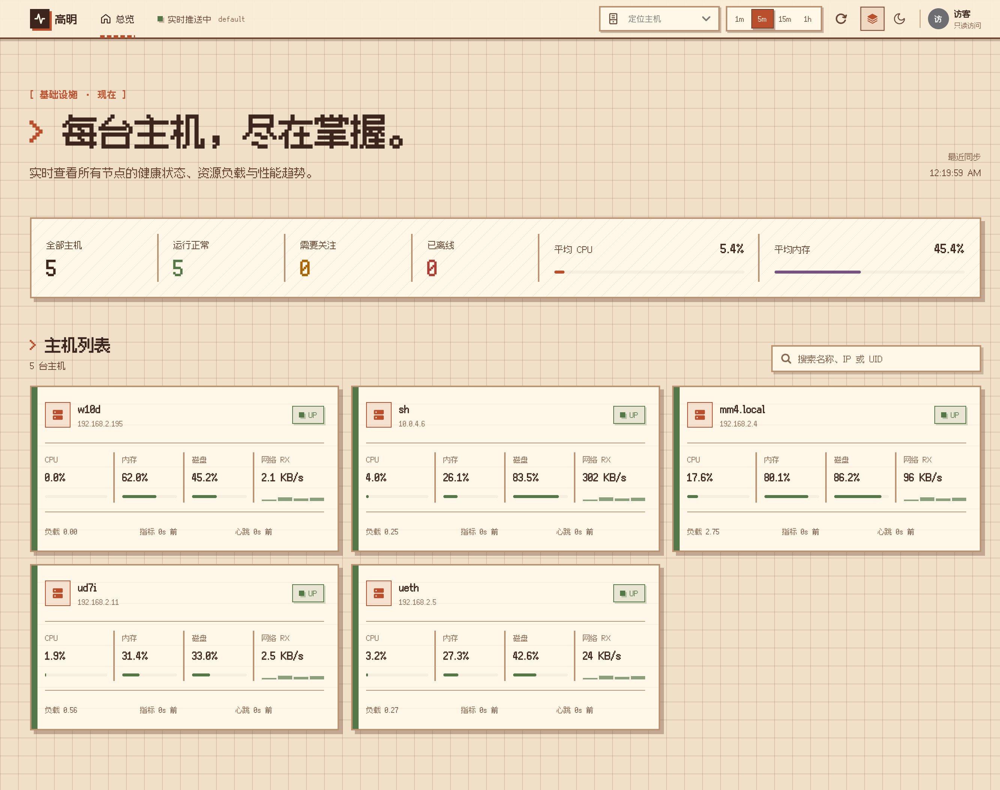
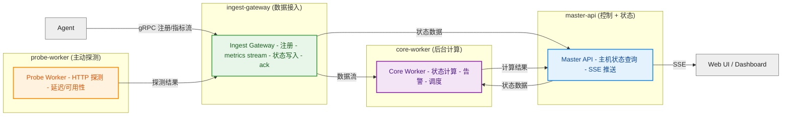

# 高明 / Gaoming


> 高明是明代神魔小说《封神演义》中的虚拟角色，本体为棋盘山桃精，与其弟柳鬼高觉（顺风耳）并称千里眼。

## 🚀 快速体验

```bash
curl -fsSL https://raw.githubusercontent.com/gofxq/gaoming/master/deployments/install-agent.sh | sudo sh
```

安装完成后展示：
```bash
web-url [https://gm-metric.gofxq.com/]:
ingest-grpc-addr [gm-rpc.gofxq.com:443]:
tenant [<auto>]:
loop-interval-sec [5]: 1
[+] downloading gaoming-agent_linux_amd64.tar.gz
[+] installed gaoming-agent to /opt/gaoming-agent
[+] config: /opt/gaoming-agent/agent-config.yaml
[+] tenant_code: default
[+] dashboard: https://gm-metric.gofxq.com/default
```


安装完成后打开dashboard即可。手机端可打开增加 pwa 支持安装至手机。

[PWA](https://gm-metric.gofxq.com/default/pwa)


一个面向主机与节点的轻量监控系统：Agent 自动注册、持续上报指标，Web 端按租户展示实时状态。


🔗 在线 Demo: [https://gaoming.gofxq.com/default](https://gaoming.gofxq.com/default)
## WEB


## ✨ 核心能力

- Agent 自动注册、流式指标上报
- Dashboard 实时展示主机状态与窗口指标
- 租户隔离：页面走 `/<tenantCode>`，接口走 `?tenant=...`
- 支持 Linux / macOS / Windows 安装脚本
- 支持 Docker 启动后端，本机直跑 Agent 调试
  

## 💻 系统方案





## ⚡️ 快速开始

推荐本地直接运行，不使用 Docker：四个业务后端集成到一个 Go 服务中，使用本机 PostgreSQL 和 Redis；Agent 单独运行，采集宿主机数据。

首次准备依赖与配置，详见[本地开发与验证](docs/02-guides/local-development.md)：

```bash
make deps-up       # 启动项目自己的本机 PostgreSQL / Redis，首次生成随机凭据
make dev           # 迁移数据库，启动统一后端与前端；Ctrl-C 停止
make deps-down     # 停止本机依赖，保留数据
```

页面地址：`http://127.0.0.1:5173/default`。统一 HTTP 端口 8080 同时提供 `/master/*` 和 `/ingest/*`，gRPC 端口 8091 提供 Agent 接入；端口均监听 `0.0.0.0`。

另一终端准备 `agent-config.yaml` 并运行：

```yaml
master_api_url: "http://127.0.0.1:8080"
ingest_gateway_grpc_addr: "127.0.0.1:8091"
region: local
env: dev
role: node
tenant_code: default
loop_interval_sec: 1
```

```bash
make run-agent
```

网页没有默认测试账号，按[本地登录步骤](docs/02-guides/local-development.md#3-创建测试管理员)创建管理员后登录。

常用命令：

```bash
make backend       # 只运行统一后端
make air           # 热更新统一后端 + 前端
make smoke         # 验证统一后端健康及接入计数器
make test          # Go 测试
make web-install   # 首次安装前端依赖
make test-all      # Go + 前端测试
make help          # 分组命令说明
```

端口冲突时用 `make dev HTTP_PORT=18080 GRPC_PORT=18091 WEB_PORT=15173`，同步更新 Agent 地址和配置里的 `allowed_origins`。数据库端口在 `config/server.yml` 中设置。

本机依赖需要先安装 PostgreSQL 服务端和 Redis，数据保存在 `.local-data/`，`make clean` 会保留。使用已有本机实例时可执行 `make dev-init` 并修改配置中的凭据。

Docker 配置仍保留，容器方式显式执行 `make docker-up` / `make docker-down`；前端独立启动使用 `make web-dev`。

## 📦 安装 Agent

mac/ linux 一行安装命令：

```bash
curl -fsSL https://raw.githubusercontent.com/gofxq/gaoming/master/deployments/install-agent.sh | sudo sh
```

安装脚本会交互式提示以下参数，直接回车就用默认值：

- `web-url`: `https://gm-metric.gofxq.com/`
- `ingest-grpc-addr`: `gm-rpc.gofxq.com:443`
- `tenant`: 留空则由安装脚本调用 `master-api` 申请，失败则本地生成
- `loop-interval-sec`: `5`

如果安装目录里已经存在 `agent-config.yaml`，脚本会给出两个选项：

- `update binary only`: 仅更新二进制，保留当前配置
- `reinstall`: 重装并重写配置；现有配置值会作为默认值回填到提示里

安装完成后，脚本会输出：

- `tenant_code`
- 带 tenant 的 Dashboard 地址
- 带 tenant 参数的 Hosts API 地址

平台行为：

- Linux 注册为 `systemd` 服务
- macOS 注册为 `launchd` 服务
- Windows 使用 PowerShell 安装脚本，通过 `WinSW` 注册为 Windows Service，默认安装到 `%LOCALAPPDATA%\GaomingAgent`，脚本会自动弹出 UAC 提权

Windows 安装：

```powershell
powershell -ExecutionPolicy Bypass -Command "iwr https://raw.githubusercontent.com/gofxq/gaoming/main/deployments/install-agent.ps1 -UseBasicParsing | iex"
```

Windows 卸载：

```powershell
powershell -ExecutionPolicy Bypass -Command "iwr https://raw.githubusercontent.com/gofxq/gaoming/main/deployments/uninstall-agent.ps1 -UseBasicParsing | iex"
```

Linux / macOS 卸载：

```bash
curl -fsSL https://raw.githubusercontent.com/gofxq/gaoming/main/deployments/uninstall-agent.sh | sudo sh
```

如果需要指定版本：

```bash
curl -fsSL https://raw.githubusercontent.com/gofxq/gaoming/main/deployments/install-agent.sh | sudo VERSION=v0.1.0 sh
```

如果你已经在目标机器拉了仓库代码，想用本地最新代码覆盖安装服务：

```bash
make install-agent-local-service
```

直接运行本地安装脚本时，会优先查找仓库内的 `.tmp/gaoming-agent`；如果没有显式传 `--bin`，脚本也会尝试自动执行：

```bash
go build -o .tmp/gaoming-agent ./agent/daemon/cmd/agent
```

相关脚本：

- [deployments/install-agent.sh](deployments/install-agent.sh)
- [deployments/install-agent-local.sh](deployments/install-agent-local.sh)
- [deployments/install-agent.ps1](deployments/install-agent.ps1)

## 🧩 服务组成

- `master-api`: 主机状态查询、SSE 推送
- `ingest-gateway`: Agent 注册、指标流、事件、探测数据接入
- `core-worker`: 后台计算与聚合
- `probe-worker`: 主动探测
- `agent`: 主机侧采集与上报

## 📚 文档

- [中文文档概要与索引](docs/README_cn.md)
- [系统架构](docs/01-core/architecture.md)
- [本地开发与验证](docs/02-guides/local-development.md)
- [接口与数据模型](docs/03-reference/api-and-data.md)
- [仓库结构](docs/03-reference/repository-layout.md)
